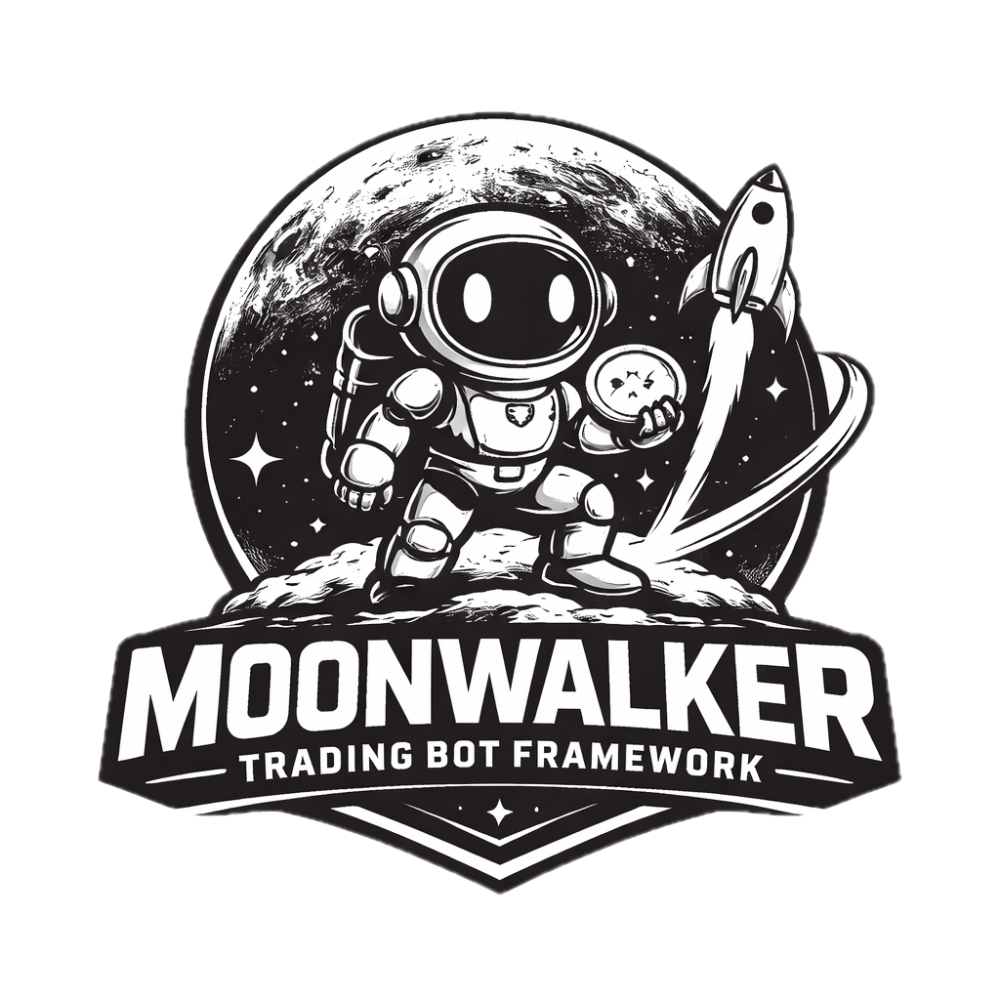

# Moonwalker

<p align="center">
  
</p>

## Summary
Moonwalker is a self-hosted cryptocurrency trading bot with a Litestar backend,
Vue dashboard, exchange integration via CCXT/CCXT Pro, and support for
signal-driven entries, Dynamic DCA management, and accumulation with manual
exits. It also includes an Autopilot Memory cockpit that surfaces favored and cooling symbols, suggested
base orders, and plain-language trust signals in the Control Center.

## Trade Mode and Safety Orders

Choose **Dynamic DCA** for deals with safety orders and configured exits, or
**Accumulation** to retain selected spot coins until an explicit sale. ASAP opens
an accumulation holding with the configured base order; its pinned strategy
controls later purchases. CSV can adopt coins already owned. See the
[accumulation operating guide](docs/howto-operate-accumulation.md) or try the
[backtest tutorial](docs/tutorial-accumulation-backtest.md) without placing orders.

Dynamic DCA's Expert safeguards offers three safety-order sizing modes: Legacy
factors, Recovery shadow, and Recovery target. See
[safety-order sizing](docs/dynamic-so.md) for behavior and budget limits.
Sidestep is no longer supported. Legacy Sidestep values are normalized during
startup and restore; valid accumulation records retain their lifecycle.

## Disclaimer
**Moonwalker is meant to be used for educational purposes only. Use with real funds at your own risk**

## Deployment Model
- Moonwalker is designed to run as a **single-node, single-instance** app.
- One instance owns its own DB, configuration, watcher/runtime state, and
  trading engine.
- It is normal to have **multiple dashboard clients** connected to the same
  instance at the same time.
- Separate Moonwalker installs are intentionally isolated from each other.

## Prerequisites
- Python 3.14 (the verified patch release is in `.python-version`)
- Node.js 24 LTS (the verified patch release is in `.nvmrc`)
- TA-Lib installed for your OS
- Configured API access on your exchange

Linux is the most typical deployment target, but any environment that supports
Python, Node.js, and TA-Lib can work.

### Run Script (Recommended)
1. Start everything with `./run.sh start -p "port"`.
   - Debug logs: `./run.sh start --debug`
   - Trace logs: `./run.sh start --trace`
2. Stop with `./run.sh stop`.

The script builds the Vue frontend, copies assets into the backend, creates a
Python venv, installs backend deps, and starts the Litestar app in the
background. Logs go to `run.log`.

By default the app listens on port `8130`. The backend runtime is intentionally
single-process because the trading engine uses shared in-memory runtime state.

### Full Verification
Run the full backend and frontend verification suite with:

```bash
cd scripts && ./ci.sh
```

Dependency updates, lock regeneration, supply-chain checks, and the documented
CCXT exception are covered in `docs/dependencies.md`.

### TA-Lib dependency
You also need to install the ta-lib library for your OS. Please see: https://ta-lib.org/install/#linux-debian-packages

## Documentation
- [Documentation index](docs/README.md)
- [Accumulation: setup, operation and manual exits](docs/howto-operate-accumulation.md)
- [Accumulation recovery](docs/howto-recover-accumulation.md)
- [Reviewed dependency updates](docs/howto-update-dependencies.md)
- Release notes: `CHANGELOG.md`
- Current tracked release version: `VERSION`
- Configuration and full key reference: `docs/configuration.md`
- API and websocket reference: `docs/api.md`
- Monitoring (Telegram): `docs/monitoring.md`
- [Expert safeguards and safety-order sizing modes](docs/dynamic-so.md)
- [AI Trust local calibration](docs/ai-trust.md)
- [Developer documentation and documentation policy](docs/development.md)
- Signal plugin setup (SymSignals, ASAP, CSV, WebSocket): [Signal plugins](docs/signals.md)
- CI, runtime operations, backups, logs, and dashboard streams:
   `docs/operations.md`
- Dependency updates and supply-chain policy: `docs/dependencies.md`
- Product record: `PRODUCT.md`
- Statistics dashboard: `/stats` in your browser
